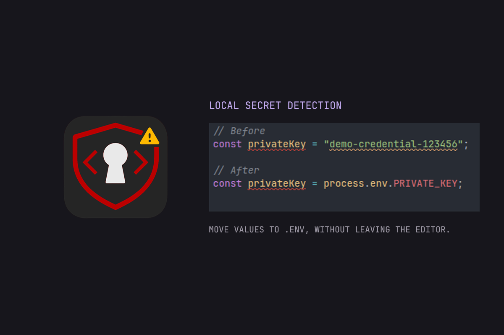
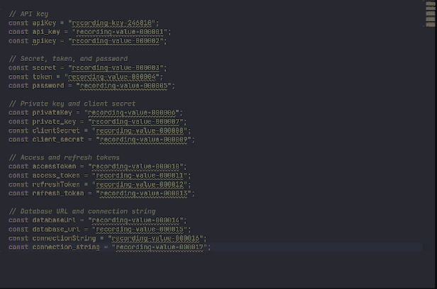
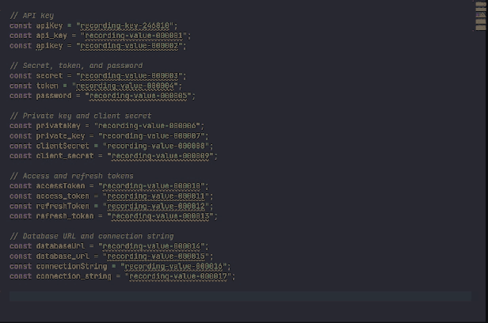
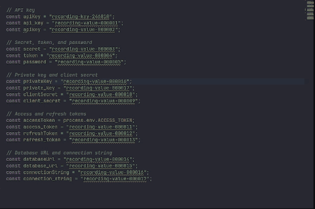
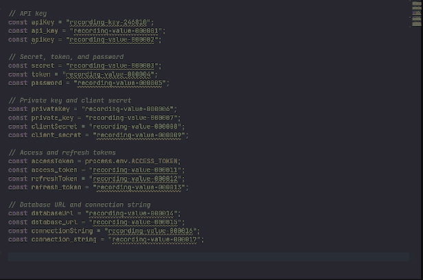

# Safe Code

**Catch hardcoded secrets while you work in VS Code.**

Safe Code scans supported files in your workspace and highlights possible API keys, tokens, passwords, private keys, and database credentials in the editor and **Problems** tab. It runs locally in VS Code and offers quick fixes for supported cases.

[Install from the Visual Studio Marketplace](https://marketplace.visualstudio.com/items?itemName=matheus-tecchio.safe-code)

## Features

### Secret detection in the editor

Safe Code highlights suspicious values with warning underlines and lists them in **Problems**. It scans supported files when the extension starts and updates findings as files change. Detection includes suspicious assignments, private key headers, credential-bearing database URLs, and selected GitHub, AWS, and Stripe key formats.



### Workspace scanning

Run **Safe Code: Scan Workspace** to check supported open and unopened files across your workspace. The scan shows cancellable progress, and findings stay in **Problems** after you close a file. You can also run **Safe Code: Scan Open Files** for currently open workspace files.

### Move a value to `.env`

For a supported simple JavaScript or TypeScript assignment, choose **Move value to .env**. Safe Code replaces the literal with an environment lookup, writes the value to the workspace root `.env`, and updates `.gitignore` to protect that file. It leaves `.env.example` untouched.

```ts
// Before: fictional example value
const clientSecret = "demo-credential-987654";

// After
const clientSecret = process.env.CLIENT_SECRET;
```

The fix is available only when Safe Code can safely identify and update the assignment. Review the resulting code and provide the environment variable when you run your application.



### Ignore a known false positive

Choose **Ignore this warning** to suppress one occurrence in your local VS Code workspace storage. Choose **Ignore this warning type for this project** to suppress every finding from that detection rule in the workspace folder; this writes `.vscode/.safe-code.json` so the choice can be shared with your team. The project option can also hide future real findings from that rule, so use it deliberately.

**Ignore one warning**



**Ignore a warning type for this project**


